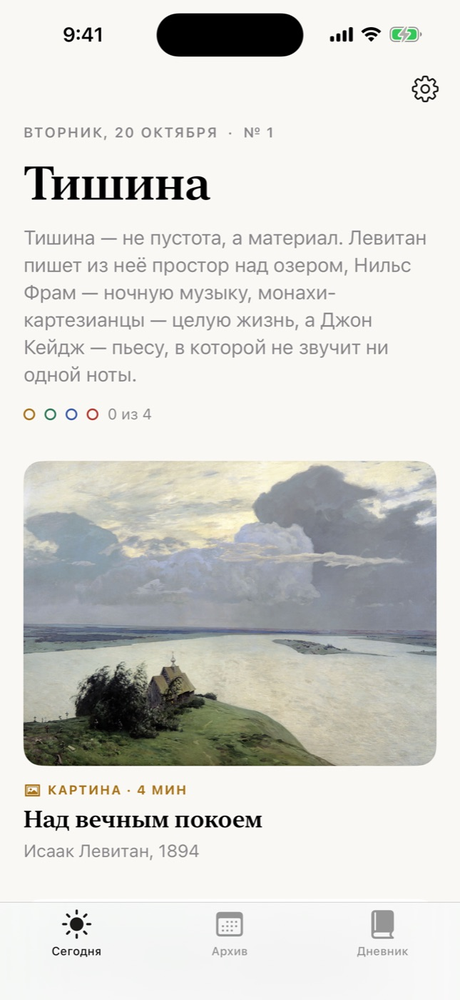
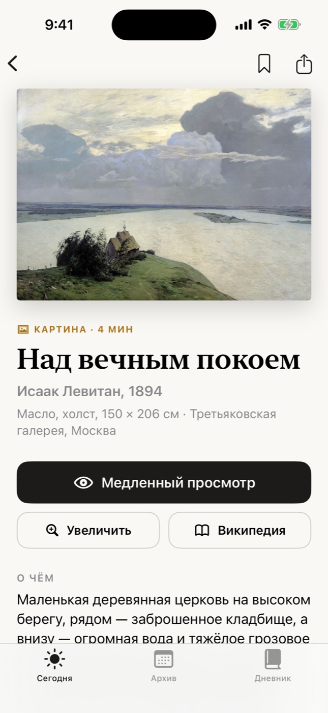
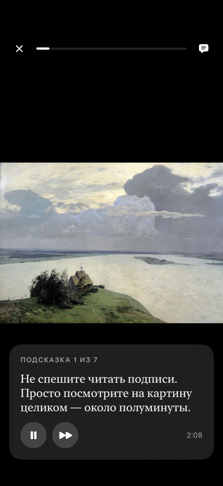
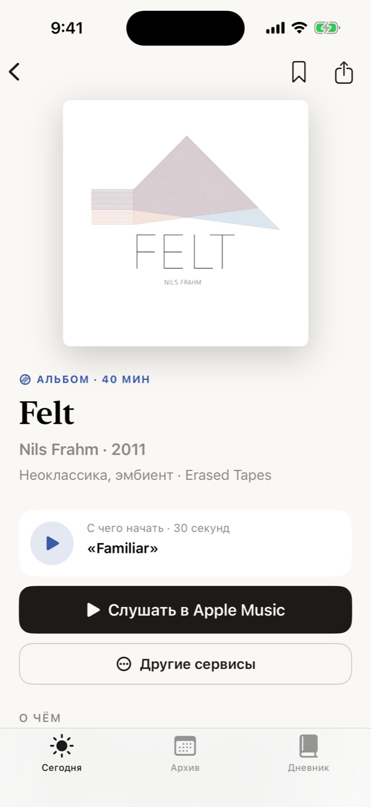
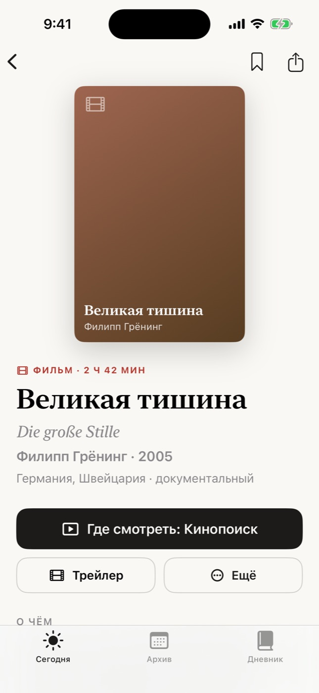
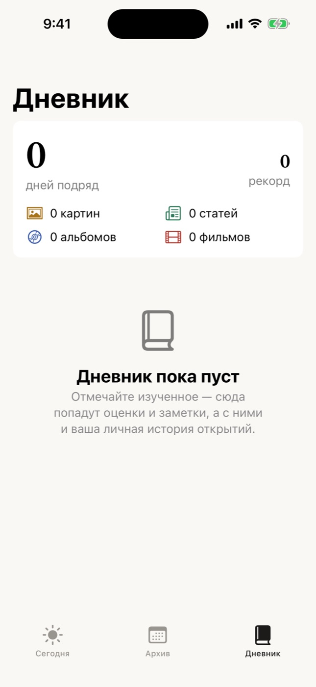
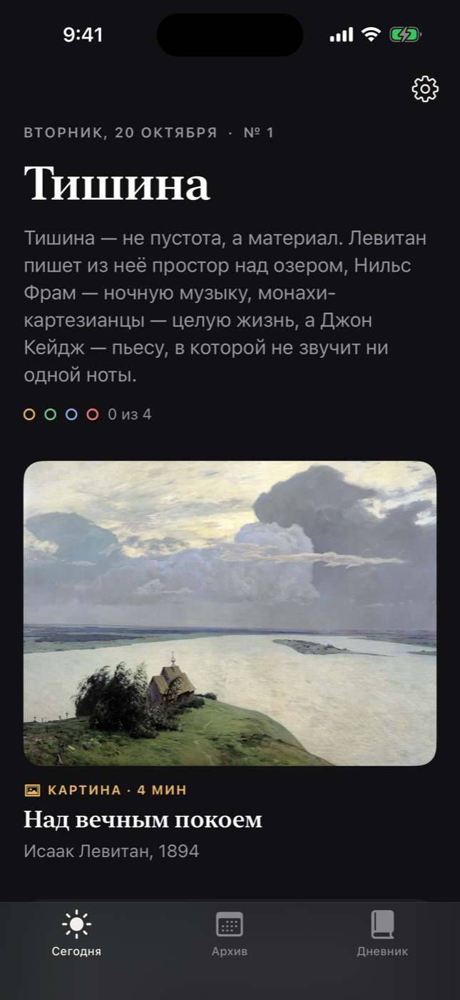

# Квартет

**Каждый день — четыре открытия, связанные одной темой:** картина, статья, альбом и фильм.

Приложение для iPhone (iOS 17+) с виджетами для экрана «Домой» и экрана блокировки.
В первый день тема — «Тишина»: Левитан, пьеса Джона Кейджа без единой ноты, ночная музыка Нильса Фрама
и фильм о монахах-картезианцах. На второй — «Зима», на третий — «Ночной город».
В каталоге 45 тематических выпусков (180 рекомендаций), его легко пополнять.

<p>




</p>
<p>




</p>

Скриншоты сняты автоматически в симуляторе iPhone — остальные в [docs/screenshots](docs/screenshots).

## Чем «Квартет» отличается

- **Тема дня вместо случайной ленты.** Четыре рекомендации связаны общей идеей, короткое вступление объясняет связь.
  Это не бесконечная лента: один выпуск в день, который реально успеть.
- **Медленный просмотр картин.** Пошаговые подсказки на 20 секунд каждая («найдите…», «сравните…»)
  учат смотреть, а не пролистывать. Плюс увеличение до мазка.
- **Встроенная читалка.** Статья открывается сразу в приложении в аккуратной вёрстке без рекламы
  (Mozilla Readability, та же технология, что у Firefox): светлая, сепия и тёмная темы, размер текста,
  чтение без сети после первого открытия, переключение на оригинал.
- **30 секунд, чтобы решить.** Фрагмент ключевого трека альбома и трейлер фильма прямо на экране рекомендации.
  Дальше — одна кнопка в выбранный сервис: Apple Music, Яндекс Музыка, Spotify или YouTube Music;
  для фильмов — Кинопоиск, Apple TV, IMDb или Letterboxd.
- **Дневник открытий.** Отметки, оценки от «не моё» до «восторг», заметки, серия дней подряд, статистика,
  экспорт в Markdown. Отложенное — в закладках.
- **Интерактивный виджет.** Отмечать изученное можно прямо на экране «Домой», не открывая приложение.
- **Карточка для сторис.** Красивая картинка 9:16 с рекомендацией — поделиться одним нажатием.
- **Без регистрации, рекламы и ключей API.** Всё хранится на телефоне. Изображения картин — из Википедии,
  обложки и фрагменты — из открытого iTunes Search API.

## Возможности

| Раздел | Что умеет |
|---|---|
| Сегодня | Тема, вступление, четыре карточки, прогресс дня, серия дней подряд |
| Картина | Изображение в высоком разрешении, медленный просмотр, увеличение, «на что смотреть», факт, что дальше |
| Статья | Читалка с темами и размером текста, офлайн-кэш, оригинал в Safari, кнопка «Прочитано» в конце |
| Альбом | Обложка, 30-секундный фрагмент, «Слушать» в выбранном сервисе, страница об альбоме |
| Фильм | Постер, трейлер, «Где смотреть», страница о фильме |
| Архив | Все прошедшие выпуски и отложенные рекомендации |
| Дневник | Оценки, заметки, статистика по типам, серия и рекорд, экспорт |
| Настройки | Какие типы показывать, ежедневное напоминание, сервисы, оформление читалки, сброс |
| Виджет «Квартет дня» | Малый, средний, большой (с отметками), на экране блокировки — круг прогресса, строка, прямоугольник |
| Виджет «Рекомендация дня» | Одна картина, альбом, фильм или статья — на выбор; картина в режиме StandBy как цифровая рамка |

Ещё: тёмная тема, поддержка крупного шрифта и VoiceOver, ссылки вида `kvartet://` для «Команд».

## Что в репозитории

```
Kvartet.xcodeproj          проект Xcode: приложение и расширение с виджетами
Config/                    настройки сборки (Base.xcconfig), Info.plist, entitlements
Shared/                    общий код приложения и виджета
  Core/                    настройки (AppConfig.swift), даты, App Group
  Model/                   модели: выпуск, рекомендация, отметки
  Store/                   каталог, хранилище отметок, настройки
  Media/                   поиск и кэш изображений, обложек, фрагментов
  Resources/catalog.json   все выпуски
Kvartet/                   приложение: экраны, читалка, медленный просмотр, дневник, настройки
KvartetWidget/             виджеты
scripts/                   проверка каталога, скриншоты в симуляторе
docs/                      формат каталога, скриншоты
.github/workflows/         сборка и скриншоты в облаке GitHub Actions
```

## Как установить на свой iPhone

### Что понадобится

- **Mac** с Xcode 16 или новее — Xcode бесплатный, ставится из Mac App Store.
  Проект проверен на Xcode 16.4 и Xcode 26. Без Mac собрать и подписать iOS-приложение нельзя;
  если Mac нет, можно арендовать облачный (например, MacinCloud) или попросить знакомого.
- **iPhone с iOS 17** или новее и кабель (потом можно по Wi‑Fi).
- **Apple ID.** Для установки на свой телефон хватит бесплатного. Для TestFlight и App Store нужна
  платная программа Apple Developer Program (99 $ в год).

### Шаг 1. Скачайте код

На странице репозитория на GitHub выберите ветку `claude/ios-content-recommendations-app-a4i8qz`,
нажмите **Code → Download ZIP** и распакуйте архив. Или в Терминале:

```bash
git clone -b claude/ios-content-recommendations-app-a4i8qz https://github.com/artyomvorobiov/sviluppo.git
```

### Шаг 2. Откройте проект

Дважды щёлкните `Kvartet.xcodeproj`. При первом открытии Xcode может предложить установить
компоненты iOS — согласитесь.

### Шаг 3. Подключите Apple ID

Xcode → **Settings… → Accounts** → «+» → **Apple ID** → войдите.

### Шаг 4. Укажите свой идентификатор и команду

Откройте в Xcode файл `Config/Base.xcconfig` и замените `com.example` на что-нибудь своё
(латиница, цифры, точки и дефисы), например:

```
BUNDLE_ID_PREFIX = com.ivanpetrov
```

Идентификатор должен быть уникальным среди всех разработчиков Apple, поэтому `com.example` не подойдёт.

Затем выберите команду: в левой панели нажмите на проект **Kvartet** → таргет **Kvartet** →
вкладка **Signing & Capabilities** → **Team** — ваше имя (Personal Team). Галочка
**Automatically manage signing** должна стоять. То же самое — для таргета **KvartetWidgetExtension**.
(Вместо этого можно один раз вписать Team ID в `DEVELOPMENT_TEAM` в том же файле.)

### Шаг 5. Запустите

1. Подключите iPhone кабелем, разблокируйте его и нажмите «Доверять этому компьютеру».
2. Вверху окна Xcode выберите свой iPhone в списке устройств.
3. Нажмите ▶︎ (или **⌘R**).
4. При первом запуске iPhone попросит включить **режим разработчика**:
   **Настройки → Конфиденциальность и безопасность → Режим разработчика**, затем перезагрузка.
5. С бесплатным Apple ID разрешите запуск: **Настройки → Основные → VPN и управление устройством** →
   ваш Apple ID → **Доверять**. Нажмите ▶︎ в Xcode ещё раз.

### Шаг 6. Добавьте виджеты

- **Экран «Домой»:** долгое нажатие на пустом месте → **Изменить → Добавить виджет** → «Квартет» →
  «Квартет дня» (три размера) или «Рекомендация дня». Тип рекомендации выбирается долгим нажатием
  на виджет → **Изменить виджет**.
- **Экран блокировки:** долгое нажатие на экране блокировки → **Настроить** → экран блокировки →
  поле виджетов → «Квартет».

Откройте приложение хотя бы раз в день — оно заранее скачивает картинки на сегодня и завтра,
поэтому виджет показывает их даже без сети.

### Важно про бесплатный Apple ID

- Приложение, подписанное бесплатным аккаунтом, работает **7 дней**. Потом его нужно снова
  установить из Xcode (подключить телефон и нажать ▶︎) — отметки и дневник сохранятся.
- Если Xcode выдаёт ошибку про **App Groups**, удалите эту возможность в обоих таргетах
  (Signing & Capabilities → App Groups → кнопка корзины). Приложение будет работать как обычно,
  но виджет не увидит ваши отметки — приложение предупредит об этом в настройках.
  С платным аккаунтом App Groups создаются автоматически.

## Типичные ошибки при сборке

| Сообщение | Что сделать |
|---|---|
| Signing for "Kvartet" requires a development team | Выберите Team в Signing & Capabilities для **обоих** таргетов (шаг 4) |
| Failed to register bundle identifier / is not available | Поменяйте `BUNDLE_ID_PREFIX` на более уникальный |
| Ошибка подписи с упоминанием App Groups | Удалите App Groups в обоих таргетах (см. выше) |
| Could not launch "Kvartet" / Untrusted Developer | Доверьте разработчику на iPhone (шаг 5) |
| iPhone не виден в Xcode | Разблокируйте телефон, «Доверять этому компьютеру», включите режим разработчика |

## Публикация: TestFlight и App Store

1. Вступите в [Apple Developer Program](https://developer.apple.com/programs/) (99 $ в год).
2. В [App Store Connect](https://appstoreconnect.apple.com) создайте приложение с вашим Bundle ID
   (`<BUNDLE_ID_PREFIX>.kvartet`).
3. В Xcode выберите устройство **Any iOS Device**, затем **Product → Archive → Distribute App →
   App Store Connect → Upload**. Перед каждой новой загрузкой увеличивайте `CURRENT_PROJECT_VERSION`
   в `Config/Base.xcconfig` (а для новой версии — `MARKETING_VERSION`).
4. Через 10–30 минут сборка появится в **TestFlight** — пригласите себя и друзей.
5. Для App Store заполните описание, скриншоты (можно взять из `docs/screenshots`), категорию
   и анкету о конфиденциальности: приложение не собирает данные и не следит за пользователями
   (**Data Not Collected**), но нужна ссылка на политику конфиденциальности — подойдёт простая страница.
6. Перед публикацией проверьте права на контент: изображения картин — свободные файлы Wikimedia Commons,
   тексты статей принадлежат изданиям (читалка всегда ведёт на оригинал), обложки и фрагменты из iTunes
   Search API Apple разрешает использовать для продвижения контента своих сервисов — поэтому по умолчанию
   кнопка «Слушать» ведёт в Apple Music.

## Как пополнять каталог

Все выпуски — в [`Shared/Resources/catalog.json`](Shared/Resources/catalog.json).
Подробное описание полей — в [docs/catalog.md](docs/catalog.md). Коротко:

1. Добавьте новый выпуск **в конец** списка `issues`: тема, вступление и четыре рекомендации.
2. Для картины укажите статью Википедии в поле `wiki` — изображение найдётся само.
   Для альбома — `keyTrack`, чтобы был 30-секундный фрагмент.
3. Проверьте файл: `python3 scripts/validate_catalog.py`.
4. Пересоберите приложение.

Чтобы добавлять выпуски **без обновления приложения**, выложите `catalog.json` в интернет и укажите адрес
в `AppConfig.remoteCatalogURL` (см. [docs/catalog.md](docs/catalog.md#удалённый-каталог)).

## Настройки проекта в одном месте

- `Config/Base.xcconfig` — идентификатор приложения, команда, номер версии.
- `Shared/Core/AppConfig.swift` — название, адрес удалённого каталога, как часто его проверять,
  размер изображений, на сколько дней вперёд планировать напоминания.
- Иконка — `Kvartet/Assets.xcassets/AppIcon.appiconset` (обычная, тёмная и тонированная, 1024 × 1024).

## Ссылки `kvartet://`

Пригодятся для приложения «Команды» и автоматизаций:

| Ссылка | Что откроет |
|---|---|
| `kvartet://today` | Выпуск дня |
| `kvartet://archive` | Архив |
| `kvartet://journal` | Дневник |
| `kvartet://settings` | Настройки |
| `kvartet://item/<id>` | Рекомендацию (id — из каталога) |
| `kvartet://item/<id>?open=reader` | Статью сразу в читалке |
| `kvartet://item/<id>?open=look` | Медленный просмотр картины |
| `kvartet://item/<id>?open=zoom` | Картину в увеличении |

## Проверка в облаке (GitHub Actions)

- **iOS build** — при каждом коммите проверяет каталог и собирает приложение с виджетами для симулятора
  и для iPhone (без подписи) на двух версиях Xcode. Зелёная галочка у коммита — значит, проект собирается.
- **Screenshots** — запускается вручную (вкладка **Actions → Screenshots → Run workflow**): собирает
  приложение, проходит по экранам в симуляторе iPhone и сохраняет скриншоты в `docs/screenshots`.

Обе проверки бесплатны для публичных репозиториев; для приватных расходуют минуты GitHub Actions
(сборки на macOS считаются с повышающим коэффициентом).

## Конфиденциальность

Нет аккаунтов, аналитики и рекламы. Отметки, оценки, заметки и настройки хранятся только на телефоне
(в общей папке приложения и виджета). В интернет приложение обращается только за содержимым:
к API Википедии (изображения), iTunes Search API (обложки, фрагменты, трейлеры) и к сайтам статей.

## Версия для Android: план

Каталог и логика переносятся без изменений, переписывается только интерфейс.

| iOS (сейчас) | Android |
|---|---|
| SwiftUI | Kotlin + Jetpack Compose |
| WidgetKit, интерактивные виджеты | Jetpack Glance (виджеты на Compose, кнопки через `ActionCallback`) |
| Читалка: WKWebView + Readability.js | WebView + тот же `Readability.js` |
| App Group (общие файлы с виджетом) | Общее хранилище приложения: DataStore или Room |
| Локальные уведомления | WorkManager / AlarmManager + NotificationManager |
| Кэш изображений | Coil |
| `catalog.json` | Тот же файл и тот же формат ([docs/catalog.md](docs/catalog.md)) |
| Поиск в Википедии и iTunes | Те же запросы (Retrofit или Ktor) |

Порядок работы: модели и загрузка каталога → экран «Сегодня» и карточки → экраны рекомендаций
и читалка → дневник и архив → виджеты → напоминания. Удобно держать `catalog.json` по одному адресу
в интернете (удалённый каталог) — тогда обе версии получают новые выпуски одновременно.

## Благодарности и лицензии

- [Mozilla Readability](https://github.com/mozilla/readability) — режим чтения, Apache License 2.0
  (файл `Kvartet/Reader/Readability.js`).
- Изображения картин — [Wikimedia Commons](https://commons.wikimedia.org) через API Википедии.
- Обложки, фрагменты и трейлеры — [iTunes Search API](https://performance-partners.apple.com/search-api).
- Тексты статей принадлежат их авторам и изданиям (Википедия — CC BY-SA, Arzamas и другие).

Лицензия на код проекта пока не выбрана: если захотите открыть его другим, добавьте файл `LICENSE`
(например, MIT).
